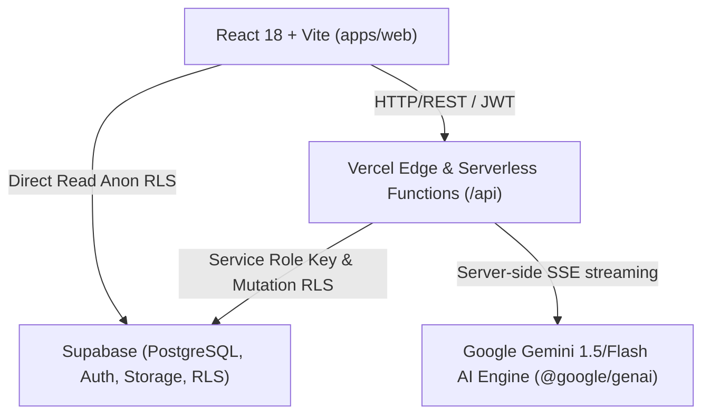

# Surakshit Bharat: System Architecture Overview

## Directory Structure
- `/apps/web`: React 18, Tailwind CSS, Lucide icons, Framer Motion, TanStack Query, React Router, Cartogram & Chart visualizers.
- `/packages/shared`: Domain types, Zod schemas, cartogram coordinates, indicator calculation helpers.
- `/api`: Node 20 TypeScript serverless functions with Zod validation, JWT verification, and Gemini assistant endpoints.
- `/supabase/migrations`: SQL schema migrations with RLS enabled on all tables.
- `/supabase/seed.sql`: Realistic demonstration dataset (`is_demo = true`).
